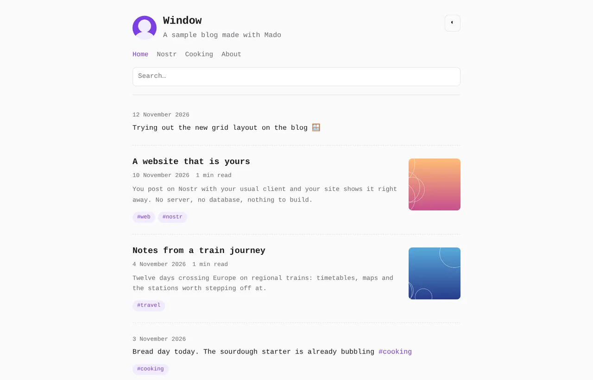
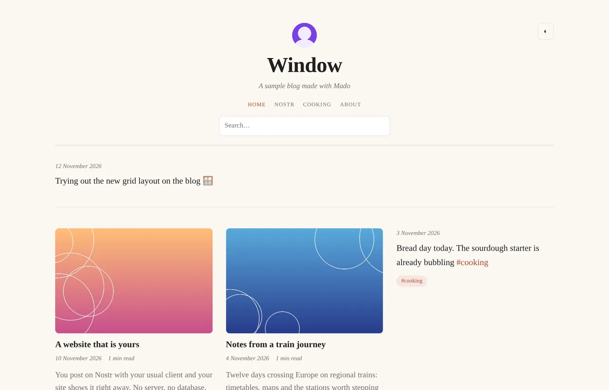
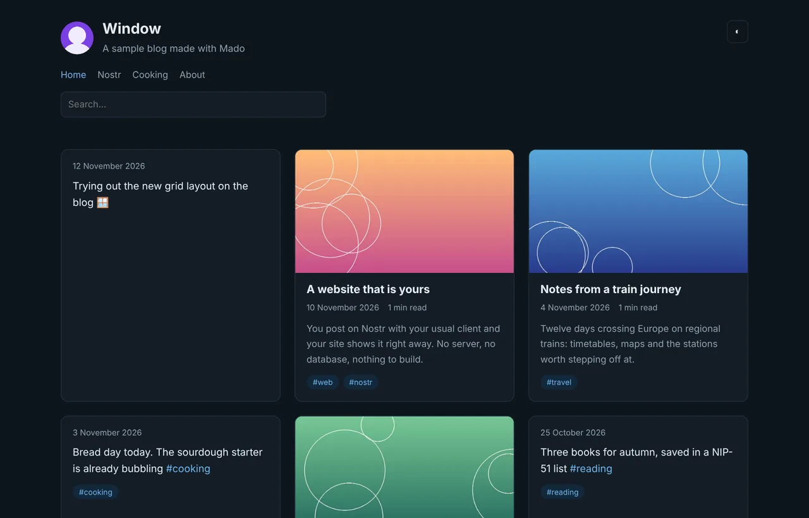

<p align="center"></p>

<h1 align="center">Mado</h1>

<p align="center"><b>Una ventana a tus publicaciones de Nostr, en tu propia web.</b><br><i>A window onto your Nostr posts, on your own website.</i></p>

<p align="center"><a href="https://oluengo.github.io/mado/">Web</a> · <a href="https://oluengo.github.io/blog/">Ver un blog real</a> · <a href="https://oluengo.github.io/mado/admin.html">Configuración</a> · <a href="#english">English</a></p>

<table><tr>
<td width="33%"></td>
<td width="33%"></td>
<td width="33%"></td>
</tr></table>

**Mado** (窓, «ventana» en japonés) convierte tus artículos (NIP-23) y notas de Nostr en una web alojada por ti, en GitHub Pages o en cualquier alojamiento estático. Publicas con tu cliente de Nostr de siempre y Mado lo muestra. Sin servidor, sin compilar y sin nada que instalar. Gratis. En castellano, català, English, italiano y Deutsch.

## Qué hace

- **Portada paginada**, enlaces permanentes, secciones por hashtag, buscador y página «Sobre mí».
- **Filtros por hashtag** (incluir/excluir, alguno/todos), publicaciones fijadas y respuestas ocultas. Opcional: barra y buscador de etiquetas para quien visita.
- **Aspecto en tres piezas independientes:** 6 diseños, 6 temas de color con modo claro y oscuro, y 3 tipografías. Combínalos y crea los tuyos.
- **Interacciones de Nostr**, cada una opcional: reacciones, comentarios en hilo, zaps, citas y reposts.
- **Configuración en Nostr (NIP-78)**, firmada con tu extensión desde `admin.html`: cambias la web sin tocar el repositorio.
- **Firmas comprobadas:** cada evento se verifica, y tu web puede demostrar que es tuya (NIP-05 o enlace firmado).

## Puesta en marcha (GitHub Pages)

1. Haz **fork** de este repositorio.
2. **Activa Pages:** *Settings → Pages → Deploy from a branch → `main` / root*.
3. Pon tu npub en `index.html` (`<meta name="mado-npub" …>`, ya está comentado) o en `config.json`. Si tu dominio tiene NIP-05 `_@dominio`, no hace falta.
4. Abre `https://TU-USUARIO.github.io/mado/admin.html`, pulsa **Conectar con extensión** (NIP-07), elige las opciones y pulsa **Publicar en Nostr**. La web lo aplica al momento.

Este repositorio es una **plantilla**: su `config.json` está vacío a propósito. Para tener tu blog dentro de otra web con solo un `index.html`, usa una [instancia ligera](docs/es/alojamiento-propio.md#instancia-ligera-recomendada-para-tu-propio-blog), como <https://oluengo.github.io/blog/>. Otras opciones (dominio propio, subcarpeta): [Alojamiento propio](docs/es/alojamiento-propio.md).

Para actualizar tu fork: **Sync fork** en GitHub. Mira antes las [novedades](CHANGELOG.md).

## Privacidad y seguridad

- Mado es una web estática: no guarda datos de nadie, no lleva analítica ni cookies y solo se conecta a los relays de Nostr.
- **Nunca escribas tu nsec en una web.** Para firmar, usa una extensión NIP-07 del navegador.
- `admin.html` no puede tocar tu repositorio, y la configuración publicada en Nostr solo se acepta si la firma la npub del autor. Puedes borrar `admin.html` y `assets/js/admin.js` cuando termines.

## Documentación

| Tema | Español | English |
|---|---|---|
| Primeros pasos | [primeros-pasos](docs/es/primeros-pasos.md) | [getting-started](docs/en/getting-started.md) |
| Referencia de configuración | [configuracion](docs/es/configuracion.md) | [configuration](docs/en/configuration.md) |
| Verificación de la web | [verificacion](docs/es/verificacion.md) | [verification](docs/en/verification.md) |
| Diseños | [disenos](docs/es/disenos.md) | [layouts](docs/en/layouts.md) |
| Temas y tipografía | [temas](docs/es/temas.md) | [themes](docs/en/themes.md) |
| Idiomas | [idiomas](docs/es/idiomas.md) | [languages](docs/en/languages.md) |
| Alojamiento propio | [alojamiento-propio](docs/es/alojamiento-propio.md) | [self-hosting](docs/en/self-hosting.md) |

## Desarrollo

HTML, CSS y JavaScript sin dependencias ni compilación.

```
index.html              la web
admin.html              página de configuración (publica en Nostr)
config.json             opcional: npub y ajustes sin Nostr
assets/css, assets/js   estilos, Nostr, rutas, textos en 5 idiomas, verificación de firmas (@noble, MIT)
assets/img              logo, favicons y avatar por defecto (ver CREDITS.md)
layouts/, themes/       diseños y temas de color (layouts.json, themes.json)
fonts/fonts.json        tipografías
examples/instance/      instancia ligera (solo index.html)
site/                   web del proyecto (oluengo.github.io/mado); no hace falta en los forks
docs/es, docs/en        documentación
```

## Apoya el proyecto

Si Mado te resulta útil:

- **Lightning / zaps:** `oluengo@rizful.com`
- **Bitcoin:** `bc1pnvdct6hfnh67p7dcg2e5mdveyz8jlxuzv4yflkxqccc72qkuc8ls8raspa`
- **Nostr:** [npub1vuf2g6s0mcjr34lhkg2vvtj4x65w29xn28nznw9fhcqcpyr4zc9q6myguj](https://njump.me/npub1vuf2g6s0mcjr34lhkg2vvtj4x65w29xn28nznw9fhcqcpyr4zc9q6myguj)

---

[Novedades](CHANGELOG.md) · [Informar de un problema](https://github.com/oluengo/mado/issues) · [Créditos](CREDITS.md) · [Licencia MIT](LICENSE)

<sub>Hecho con IA · probado por humanos.</sub>

---

<h2 id="english">English</h2>

**Mado** (窓, Japanese for “window”) turns your Nostr articles (NIP-23) and notes into a website you host yourself, on GitHub Pages or any static host. You publish with your usual Nostr client and Mado shows it. No server, no build step, nothing to install. Free. In Castellano, Català, English, Italiano and Deutsch.

**[Website](https://oluengo.github.io/mado/)** · **[See a real blog](https://oluengo.github.io/blog/)** · **[Settings](https://oluengo.github.io/mado/admin.html)**

### What it does

- **Paginated home page**, permanent links, hashtag sections, search and an “About” page.
- **Hashtag filters** (include/exclude, any/all), pinned posts and hidden replies. Optional: a tag bar and tag search for visitors.
- **Look in three independent pieces:** 6 layouts, 6 colour themes with light and dark mode, and 3 typefaces. Mix them and make your own.
- **Nostr interactions**, each optional: reactions, threaded comments, zaps, quotes and reposts.
- **Settings on Nostr (NIP-78)**, signed with your extension from `admin.html`: change the site without touching the repository.
- **Verified signatures:** every event is checked, and your site can prove it's yours (NIP-05 or a signed link).

### Quick start (GitHub Pages)

1. **Fork** this repository.
2. **Enable Pages:** *Settings → Pages → Deploy from a branch → `main` / root*.
3. Put your npub in `index.html` (`<meta name="mado-npub" …>`, already there as a comment) or in `config.json`. Not needed if your domain has NIP-05 `_@domain`.
4. Open `https://YOUR-USER.github.io/mado/admin.html`, click **Connect with extension** (NIP-07), choose your options and click **Publish to Nostr**. The site applies them right away.

This repository is a **template**: its `config.json` is empty on purpose. To run your blog inside another site with a single `index.html`, use a [lightweight instance](docs/en/self-hosting.md#lightweight-instance-recommended-for-your-own-blog), like <https://oluengo.github.io/blog/>. Other options (own domain, subfolder): [Self-hosting](docs/en/self-hosting.md).

To update your fork: **Sync fork** on GitHub. Check the [changelog](CHANGELOG.md) first.

### Privacy and security

- Mado is a static website: it stores nobody's data, has no analytics or cookies and only connects to Nostr relays.
- **Never type your nsec into a website.** To sign, use a NIP-07 browser extension.
- `admin.html` cannot change your repository, and settings published on Nostr are only accepted when signed by the author's npub. You can delete `admin.html` and `assets/js/admin.js` when you're done.

### Documentation

See the table above: every guide is in Spanish and English.

### Development

HTML, CSS and JavaScript with no dependencies and no build step. The project structure is listed above.

### Support the project

If you find Mado useful:

- **Lightning / zaps:** `oluengo@rizful.com`
- **Bitcoin:** `bc1pnvdct6hfnh67p7dcg2e5mdveyz8jlxuzv4yflkxqccc72qkuc8ls8raspa`
- **Nostr:** [npub1vuf2g6s0mcjr34lhkg2vvtj4x65w29xn28nznw9fhcqcpyr4zc9q6myguj](https://njump.me/npub1vuf2g6s0mcjr34lhkg2vvtj4x65w29xn28nznw9fhcqcpyr4zc9q6myguj)

---

[Changelog](CHANGELOG.md) · [Report a problem](https://github.com/oluengo/mado/issues) · [Credits](CREDITS.md) · [MIT License](LICENSE)

<sub>Built with AI · tested by humans. Screenshots with a sample blog.</sub>
